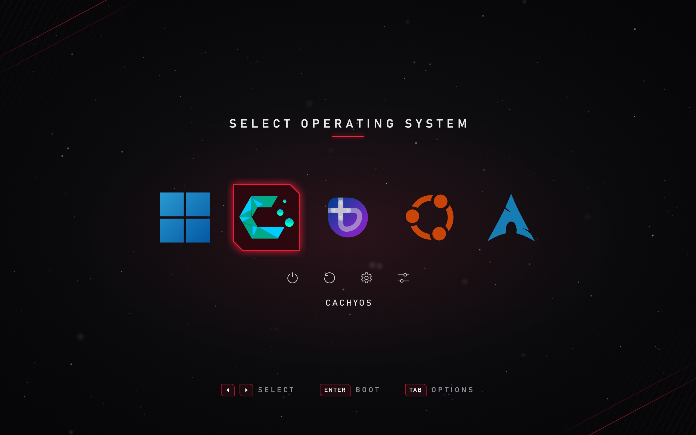
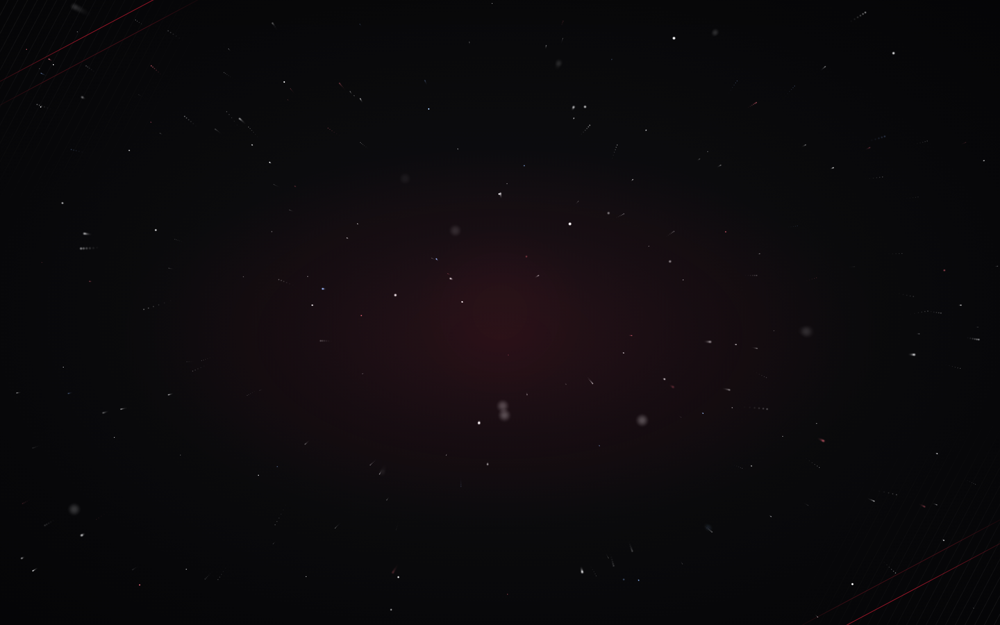
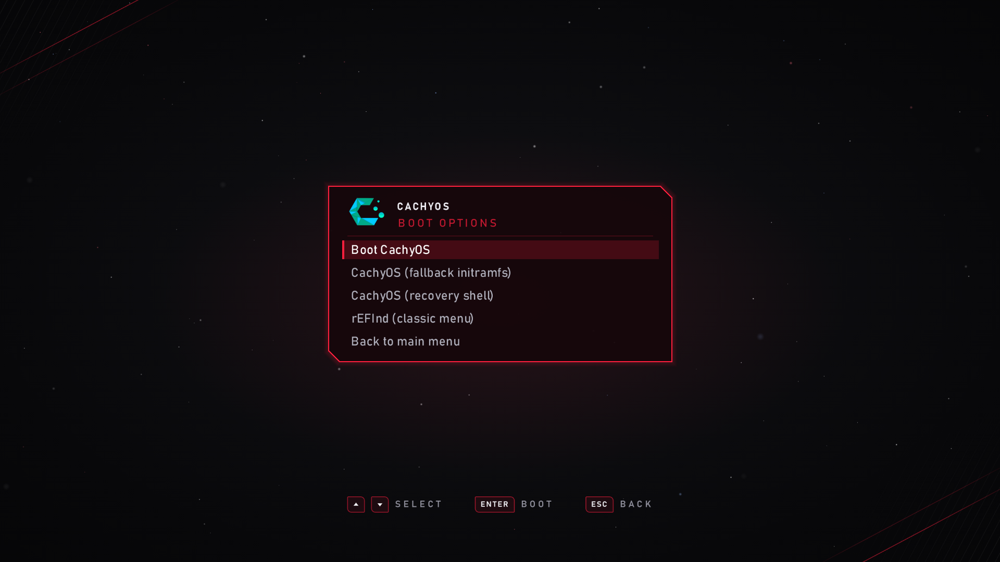
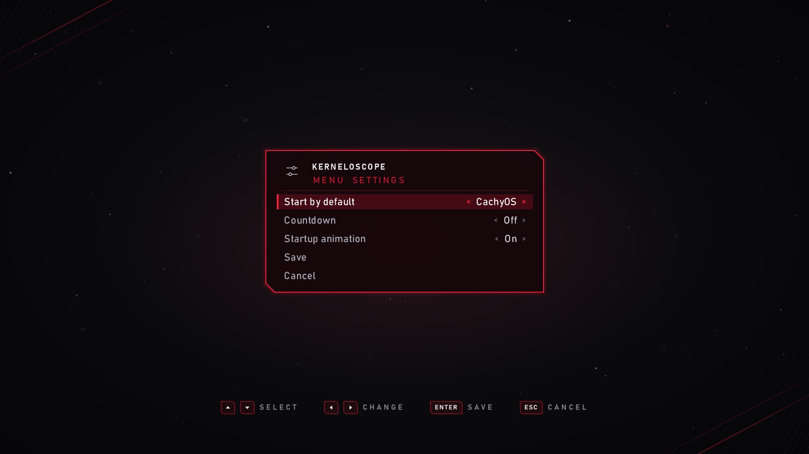
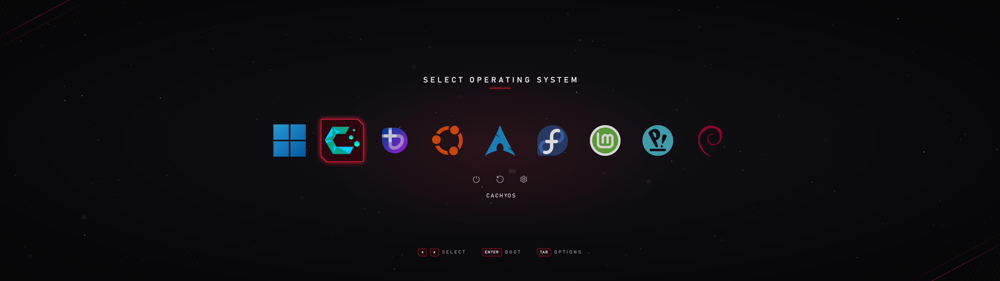

# Kerneloscope

An animated, themed **UEFI boot menu** written in Rust. It starts with a particle burst, then shows one icon per operating system over a slowly drifting starfield, in a dark theme with red accents. It's a single ~850 KB `.efi` file with all its artwork compiled in.



| Start-up burst | Boot options (Tab) | Menu settings |
|---|---|---|
|  |  |  |



## Features

- **Particle-burst intro** (about 4.5 s, any key skips it), then a starfield that keeps drifting and twinkling. Everything is drawn with sub-pixel motion at about 60 fps.
- **One icon per OS**, centred; the row scrolls with arrows when there are more entries than fit. Official logos are included for Windows, CachyOS, Bazzite, Ubuntu, Kubuntu, Debian, Arch, Linux Mint, Pop!_OS, Fedora, Nobara, openSUSE, Manjaro, EndeavourOS, Garuda, Zorin, elementary, NixOS, Kali, Gentoo, Void and SteamOS, with Tux as the fallback.
- **Boot options panel (Tab):** extra choices per OS, such as other kernels, a fallback initramfs, a recovery shell or another boot loader.
- **Menu settings page:** default OS (a fixed one, or *Last used*), countdown (off or 3 to 30 s) and the intro on or off. Saved in firmware NVRAM.
- **Any screen size and shape:** 16:10, 16:9, 21:9, 32:9, 5:4 and 4K. The background is generated for the exact resolution, and the artwork is stored at 2× so it stays sharp.
- **Native resolution:** reads the panel's preferred mode from EDID, or uses the largest mode offered, instead of the low mode many firmwares leave active.
- **Boots anything with an EFI loader:** Windows Boot Manager, Linux kernels directly via the EFI stub (with a command line), GRUB, systemd-boot or rEFInd. Every EFI partition on every drive is searched, and entries whose loader isn't found are hidden.
- **Tools row:** shut down, restart, reboot into firmware setup, and menu settings.

## Requirements

- An x86-64 PC booting in **UEFI** mode
- **Secure Boot off.** The `.efi` isn't signed; you can sign it yourself with `sbctl` if you need Secure Boot.
- Linux with `efibootmgr` to install it (or any way to copy a file to the EFI partition and add a firmware boot entry)

## Install (Linux)

```bash
git clone https://github.com/holdmysocks/kerneloscope.git
```
```bash
cd kerneloscope
```
```bash
sudo bash ./install-menu.sh
```

The installer:
1. finds your EFI partition (`/boot`, `/boot/efi` or `/efi`) and copies the prebuilt `dist/kerneloscope.efi` to `\EFI\kerneloscope\`;
2. writes a `menu.conf` for your system: a Windows entry (shown only if Windows is found) and your distro, with your kernels, fallback initramfs and a recovery shell when the kernels live on the EFI partition. Otherwise it hands over to your existing boot loader;
3. adds a **Kerneloscope** firmware boot entry and puts it first. Your other boot entries are kept.

To remove it:
```bash
sudo bash ./install-menu.sh --remove
```

**Updating from Windows** on a dual-boot machine: `.\tools\update-from-windows.ps1` replaces the installed `kerneloscope.efi` with `dist\kerneloscope.efi`, keeping a `.bak` copy, `menu.conf` and your settings. It asks for administrator rights.

## Keys

| Screen | Keys |
|---|---|
| Main | ← → choose OS · ↓ / ↑ to and from the tools row · Enter boot · Tab (or F2 / Insert) options · any key skips the intro or stops the countdown |
| Options | ↑ ↓ choose · Enter boot · Esc / Tab back |
| Menu settings (sliders icon) | ↑ ↓ choose · ← → change · Enter save · Esc cancel |

## Configuration: `\EFI\kerneloscope\menu.conf`

```
timeout 8                 # countdown in seconds (0 = wait for a key); starts after the intro
intro on                  # particle-burst intro
resolution native         # native | max | auto | <W>x<H>
default "CachyOS"

entry "Windows 11"
  icon win
  loader \EFI\Microsoft\Boot\bootmgfw.efi

entry "CachyOS"
  icon cachyos
  loader \vmlinuz-linux-cachyos
  options "root=UUID=... rw quiet splash initrd=\initramfs-linux-cachyos.img"
  sub "CachyOS (fallback initramfs)"
    options "root=UUID=... rw initrd=\initramfs-linux-cachyos-fallback.img"
```

The full format is documented at the top of [menu.conf](menu.conf). Paths use backslashes and are relative to the partition the file is on. Every EFI partition is searched, so Windows can live on another drive.

Choices saved from **Menu settings** are stored as UEFI variables `KerneloscopeSettings` and `KerneloscopeLastBoot` (vendor GUID `6d1f5c0a-8e3b-4b7e-9c2a-4f1e7d3b2a90`). They take priority over `default`, `timeout` and `intro` in the file. To go back to the file's values from Linux:
```bash
sudo chattr -i /sys/firmware/efi/efivars/Kerneloscope*-6d1f5c0a-8e3b-4b7e-9c2a-4f1e7d3b2a90 && sudo rm /sys/firmware/efi/efivars/Kerneloscope*-6d1f5c0a-8e3b-4b7e-9c2a-4f1e7d3b2a90
```

## Building

```bash
rustup target add x86_64-unknown-uefi
```
```bash
cargo build --release --target x86_64-unknown-uefi
```
The result is `target/x86_64-unknown-uefi/release/kerneloscope.efi`. `install-menu.sh` prefers a fresh build over `dist/`.

### Preview in QEMU (Windows)

`preview.ps1` boots the menu in QEMU with a virtual EFI partition, using Windows' hypervisor when available. The stand-in "operating systems" are copies of Kerneloscope itself, so picking one shows a real hand-off.
```bash
winget install SoftwareFreedomConservancy.QEMU
```
```bash
pwsh ./preview.ps1 -Distros bazzite,ubuntu,arch
```
More options: `-Width/-Height`, `-Screenshot shots/x.png` (headless capture), `-Keys right,tab`, `-Timeout 0`, `-ConfLines 'intro off'`. `tools/test-screens.ps1` screenshots a set of resolutions into `shots/screens/`.

### Changing the look

The artwork is generated, then compiled in from `assets/*.bin`. `tools/export-assets.ps1` (Windows, uses headless Edge) renders the title, hint bars and corner decorations from HTML/CSS, the logos and icons through `tools/render-icons.ps1`, and the fonts. Edit the CSS or colours there, re-run it, then rebuild.

## How it works

| File | Purpose |
|---|---|
| `src/main.rs` | Menu loop, layout, input, tools, settings page, frame pacing |
| `src/gfx.rs` | Software renderer: blending, bilinear and box scaling, cut-corner frames, proportional bitmap text |
| `src/stars.rs` | Starfield and the start-up burst (sub-pixel sprites, motion trails) |
| `src/bg.rs` | Background generated per resolution (vignette, glow, pinned corners; integer maths and dithering) |
| `src/edid.rs` | Native resolution from the firmware's EDID protocols |
| `src/settings.rs` | Settings and last-booted entry in NVRAM |
| `src/config.rs` | `menu.conf` parser |
| `src/launch.rs` | Finds loaders on any EFI partition and chain-loads them with a command line |
| `build.rs` | Embeds `assets/*.bin` into the binary |

UEFI apps run without the FPU's vector units, so the hot paths (blending, background generation) use integer maths and lookup tables. Frames are drawn into a back buffer and blitted to the Graphics Output Protocol. Pacing sleeps on a firmware timer, and falls back to the CPU clock when the firmware's timer is too coarse.

## Limitations

- No mouse or touchpad support.
- No sound: firmware usually doesn't expose audio to boot programs, and laptop speaker amplifiers need OS-level drivers.
- Booting a Linux kernel directly needs it on the EFI partition (Arch-style `/boot`). Otherwise point the entry at your distro's GRUB, systemd-boot or rEFInd.

## License

Kerneloscope is free software under the [GNU General Public License v3.0 or later](LICENSE). The bundled logos and pre-rendered artwork have their own terms; see [NOTICE.md](NOTICE.md).
